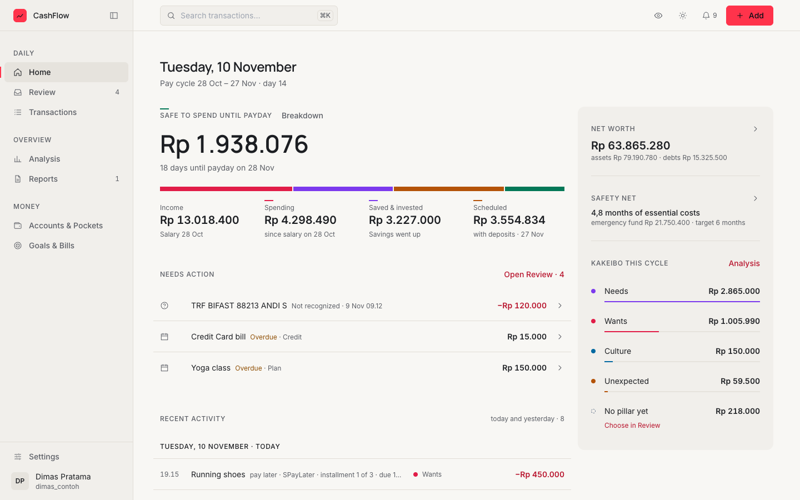
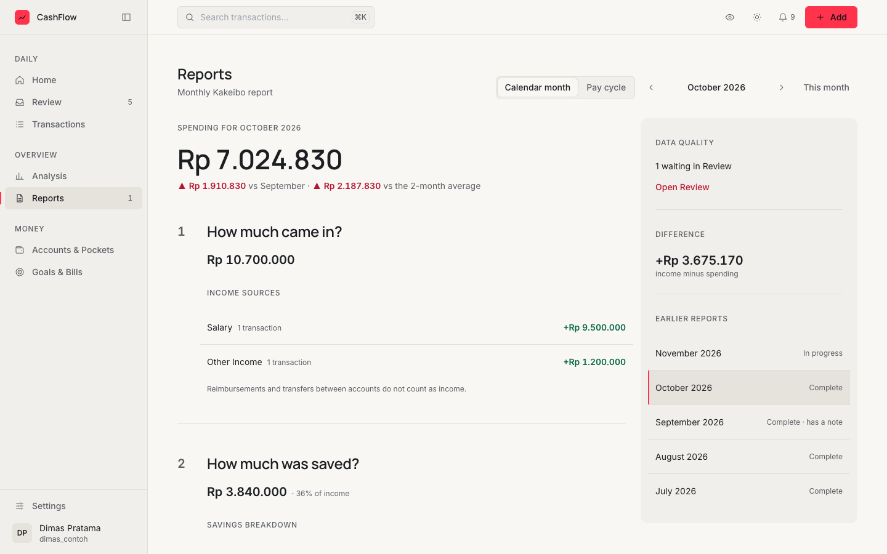
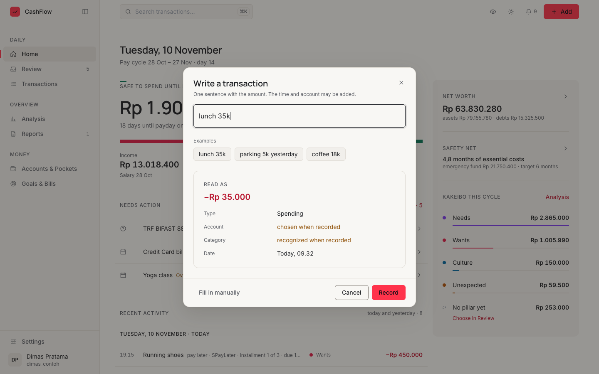

# CashFlow new-user guide

CashFlow records what comes in and goes out, and tells you how much is safe to spend until your next salary. Your
phone sends bank and e-wallet notifications; the web app turns them into transactions and asks when it is unsure.

This guide is for using the app. To run your own server, see the [README](../README.md).

## Contents

1. [First steps](#1-first-steps)
2. [How the pieces connect](#2-how-the-pieces-connect)
3. [The pages](#3-the-pages)
4. [Recording money](#4-recording-money)
5. [Habits that keep it accurate](#5-habits-that-keep-it-accurate)
6. [Privacy, language and shortcuts](#6-privacy-language-and-shortcuts)
7. [Common questions](#7-common-questions)

## 1. First steps

There is no setup wizard: after sign-up you land on **Home**. Follow these steps in order.

### Step 1: Create your account

1. On the sign-in page, choose **Create one**.
2. Choose **English** or **Bahasa Indonesia** at the foot of the card.
3. Enter a display name, a username, a password and the **Invite code** from whoever runs the server.
4. Choose a **Region**: Indonesia or United States. It sets the number and date style; the language changes words only.

Your account starts with two accounts, **Cash** and **Main account**, both at Rp 0, and a set of starter categories.

### Step 2: Choose language and theme

Open **Settings → Appearance**.

| Setting | Choices | Where it is kept |
| --- | --- | --- |
| Language | English, Bahasa Indonesia | Your account, on every device |
| Theme | Light, Dark, Match system | This browser |

The theme is also in the top bar (the sun or moon icon).

### Step 3: Add your accounts and pockets

Open **Accounts & Pockets** and choose **Add account**.

| Type | Use it for |
| --- | --- |
| Bank | A bank account, such as BCA or Jago |
| E-wallet | GoPay, ShopeePay and similar |
| Cash | Money in your wallet |
| Investment | A platform with several products (Bibit, Bareksa, Stockbit) or a single holding |
| Credit | One credit card or pay-later provider, such as SPayLater |

For each bank, e-wallet or cash account:

1. Enter the **Name** and the **Opening balance**.
2. Choose its **Use**: Everyday money, Savings, or Investment cash (money not yet invested, such as an RDN).
3. Add pockets with **Add pocket** in the account's menu, for example a Jago pocket for monthly shopping.
4. Optional: pick a **Default pocket for notifications**. Phone transactions without a pocket go there.

For a **Credit** account, enter **Owed now**, and optionally the **Limit**, **Bill issued on day** and **Due on day**.
The due day lets the app work out your bills.

The starter **Cash** and **Main account** begin at Rp 0. Rename them with **Edit account**, then enter today's balance
with **Adjust balance**. An adjustment never counts as income or spending.

### Step 4: Pair your phone

You need an Android phone (Android 8.0 or newer).

1. Open **Settings → Phone & devices** and choose **Download cashflow-companion.apk**, or scan the download QR code
   with the phone.
2. Install and open the app on the phone. Its interface is in Indonesian.
3. On the web, choose **Connect a phone**. A QR code appears. It works once and is valid for 5 minutes.
4. On the phone, choose **Mulai**, then **Scan QR**. Or choose **Ketik kode aja** and type the code under the QR.
5. Follow the phone's five setup steps: pairing, notification access, battery and background, notification
   permission and a capture test.
6. Keep the web page open. It updates by itself and ends with "The phone is ready."

> TECNO/Infinix (HiOS) and Xiaomi (MIUI) phones usually need an extra permission so the app is not frozen. Let the
> app run without battery limits.

The phone reads notifications only from these apps and drops every other notification unread:

| Bank or wallet | Apps |
| --- | --- |
| BCA | myBCA, BCA mobile |
| Bank Jago | Bank Jago |
| GoPay | GoPay, Gojek |
| ShopeePay | ShopeePay, Shopee |
| Stockbit | Stockbit |

### Step 5: Record your first transactions

- Pay with a supported app and watch the transaction appear in **Transactions**.
- For cash and other payments, press **Add** (or `N`) and type a sentence such as `lunch 35k`.
- Open **Review** and answer anything the app was unsure about.

See [Recording money](#4-recording-money) for every way.

### Step 6: Set your salary source

Do this once your salary has been recorded, by the phone or by hand.

1. Open **Settings → Salary & cycle** and choose **Choose source**.
2. Pick the salary income and choose **Make it the salary source**.
3. Confirm that income as salary: choose **Mark as salary**, or **Check income from this source** and then **This is
   salary** under **Needs review**.

A confirmed salary starts a new pay cycle. Later incomes from the same source that say "salary" or "gaji" are confirmed
automatically; unclear ones wait under **Needs review**. Until a salary is confirmed, the app uses calendar months.

### Step 7: Optional extras

| What | Where |
| --- | --- |
| Emergency fund target (1 to 36 months) and display currency (IDR or USD) | **Settings → Currency & budget** |
| Monthly spending limit | **Settings → Currency & budget** (empty means the total of category budgets) |
| Budget per category | **Analysis → Spending by category → Set budgets** |
| Savings goals and the emergency fund goal | **Goals & Bills** |
| Debts, such as a motorbike installment | **Goals & Bills → Add debt** |
| Plans for regular bills and transfers | **Plans**, on **Accounts & Pockets** or **Goals & Bills** |
| Your names as banks write them | **Settings → Profile → Names in bank notifications** |

The names in bank notifications help the app recognize transfers to and from yourself.

## 2. How the pieces connect

### Accounts and pockets

An account is where money sits: a bank, an e-wallet, cash, an investment platform or a credit provider. A pocket is
a part of an account, such as a Jago pocket. A parent account and its pockets are never counted twice.

The **Use** of an account decides where its money counts:

| Use | Counts as |
| --- | --- |
| Everyday money | Available balance |
| Savings | Available balance; money moved in counts as **Saved & invested** |
| Investment cash | Money not yet invested |
| Investments | Products such as stocks, mutual funds or gold |
| Debt | Credit accounts (set by the type) |

### Three kinds of transaction

| Kind | Example | Counts as |
| --- | --- | --- |
| Spending | Lunch, a bill, a purchase on credit | Spending, under a Kakeibo pillar |
| Income | Salary, a sale | Income |
| Transfer | BCA to Jago, a cash withdrawal, paying a credit bill | Neither: money moves between your own accounts |

A transfer between your accounts is one transfer with two sides. The phone often sees each side as a separate
notification; the app pairs them. Until both sides are known, the transfer waits in **Review** and is not counted as
spending or income.

A refund or reimbursement in the **Reimbursements** category is not income. It reduces spending in the category it
pays back.

### Kakeibo pillars and categories

Every spending has a category, and each category has a Kakeibo pillar. A single transaction can override its
category's pillar.

| Pillar | For |
| --- | --- |
| Needs | Everyday essentials: daily meals, groceries, regular transport, bills, installments |
| Wants | Can wait: cafés, snacks, eating out for fun, non-essential shopping, entertainment |
| Culture | Growth and relationships: sport, courses, books, events, offerings, planned gifts |
| Unexpected | Not planned this month: repairs, sudden medical costs, short-notice weddings, fines |
| Savings | Set aside, not spent |

Spending without a pillar shows as **No pillar yet**. It still counts as spending, but never as Needs. Manage
categories in **Analysis → Spending by category → Manage categories**.

### Salary cycles

A pay cycle runs from one confirmed salary to the next. While the next salary has not arrived, the current cycle stays
open. After three confirmed salaries that arrive on regular days, the app estimates the next payday. The estimate is
never used as a cycle boundary.

Analysis, Reports and Transactions let you switch between **Pay cycle** and **Calendar month**.

### Safe to spend

Home's main figure is **Safe to spend until payday**:

> Income − Spending − Saved & invested − Scheduled

**Scheduled** is unpaid bills and goal deposits not yet made, until the day before the expected salary. When that date
is unknown, the next 30 days are used. Choose **Breakdown** on Home to see every line behind the figure.

### Plans and bills never post on their own

A plan is a reminder, not a payment. It changes no balance. When a plan is due, you do one of three things:

1. **Link** the transaction your phone already captured.
2. **Skip this time** if it did not happen.
3. **Add manually (not captured)** if the notification was missed.

When exactly one recorded transaction matches (account, amount, around the due date), the app links it automatically.
You can undo that link.

### Goals and the safety net

- A **savings goal** follows the balance of linked accounts and pockets, or progress you enter by hand. Adding
  progress by hand moves no money.
- Mark one goal as the **emergency fund**. Without one, the safety net counts all cash balances.
- **Safety net** = the reserve balance ÷ your monthly essential costs. Essential costs come from Needs and No pillar
  yet spending in complete past periods, or from your Needs budgets when there is no complete period yet.

### Credit and pay later

| Moment | What happens |
| --- | --- |
| Purchase | Counts as spending on the purchase day. The amount owed grows; no cash balance changes. |
| Installments | A purchase can be split into 2 to 36 installments, with no interest. |
| Bill | Bills follow the account's bill and due days. |
| Payment | A transfer from a bank, e-wallet or cash account into the credit account. Cash leaves now, but it is not counted as spending again. |
| Fee or interest | Recorded as its own spending, in Credit fee. |

A payment settles the oldest amount due first. Going over the limit is marked, never refused.

## 3. The pages

On a computer, the sidebar groups the pages as **Daily**, **Overview** and **Money**. The top bar has search, **Hide
balances**, the theme, notifications and **Add**. At phone width, a bottom bar shows **Home**, **Review**,
**Transactions**, **Add** and **More**.

  

### Home

Your cycle at a glance.

- **Safe to spend until payday**, with the days until payday and **Breakdown**.
- **Income**, **Spending**, **Saved & invested** and **Scheduled** for this cycle (or this month).
- **Needs action**: notifications to answer, transfers to pair, plans and credit bills due. **Open Review** goes to the
  full list.
- **Recent activity** for today and yesterday.
- On the side: **Net worth**, **Safety net** and the Kakeibo split.

### Review

Everything the app could not settle alone, in folders:

| Folder | What it holds |
| --- | --- |
| Not recognized | Payments the app could not identify; it asks what they were for |
| Needs an answer | Groups of transactions whose category needs your answer |
| Transfer not complete | One side of a transfer, waiting for its other side |
| Recorded automatically | Recorded by a rule or AI. Checking is optional. |
| Suggestions | Proposed names and categories for older transactions. Nothing changes until you accept. |
| Seen twice | One transaction reported by two apps, recorded once |
| Skipped automatically | Reports already recorded through another app |

Answer one item at a time; the next one opens by itself. Your answers are remembered for similar transactions. Bulk
actions can be undone for 10 minutes. **Find suggestions from history**, in the page menu, proposes better names and
categories for a period you choose.

### Transactions

Every income, spending and transfer row.

- Filter by type (All, Spending, Income, Transfer, Investments, Savings & investments, Credit) and by period.
- Search notes, merchants and categories, or use **Filter** for account, category, pillar, status and source.
- Open a row for its details, including the original notification. From there: **Edit**, **Delete** or **Mark as
  checked**.
- **Merge two transactions** joins a money-out and a money-in row of the same amount from two accounts into one
  transfer.
- The **Credit** type shows each provider's amount owed and next bill.

### Analysis

Where the money went, compared with the last whole period and the recent average.

| Tab | What it shows |
| --- | --- |
| Overview | Spending by Kakeibo pillar, daily spending, spending by category, and detected bills and subscriptions |
| Calendar | Spending per day, day details and unpaid bills before the next payday |
| Money flow | A map (or table) of money from income through your accounts to spending and savings |

From **Bills & subscriptions**, **Make it a plan** turns a detected repeating payment into a plan.

### Reports

A monthly Kakeibo report, by calendar month or pay cycle. A new report shows a badge on **Reports** and a notification.

1. How much came in?
2. How much was saved?
3. How much was spent?
4. What to improve next month?

Every figure opens the transactions behind it. The **Data quality** box lists what is waiting in Review, spending
without a pillar, possible duplicates and days without records. At the end, write a **note** for the period: it shows
again in the next report.

  

### Accounts & Pockets

Balances of every account, pocket, investment and debt, with your **net worth** at the top.

- View as **Cards** or **Chart**, grouped **By use** or **By account**. **Arrange** changes the order.
- **Check balance**: compare an account with your bank app. The app lists possible causes of a difference. Then
  choose **Balance matches** or **Adjust balance**.
- Credit accounts show the limit left and the next bill, with **Pay bill**.
- Investments: **Buy** and **Sell** for stocks, gold, crypto and unit-tracked funds. A mutual fund tracked by amount
  uses **Top up** and **Update value**. **Update prices** refreshes products that have a market code.

### Goals & Bills

- The top shows how many months of essential costs your emergency fund covers, and how many days it would last if
  income stopped.
- **Bills** until the next salary (or the next 30 days), including credit bills. **Manage** opens your plans.
- **Savings goals**, with **Add goal**.
- **Debts & credit**, with **Add debt**. A debt is archived when it is paid off and becomes active again if its payment
  is reversed.

### Settings

| Section | What it is for |
| --- | --- |
| Phone & devices | Phone status, pairing, the app download, paired phones (**Revoke**) and a backup API key |
| Habits | What the app learned from your answers, and how often it asked you each week |
| Appearance | Language, theme, single-key shortcuts, **Hide balances** and help |
| Profile | Display name and the names that appear in bank notifications |
| Salary & cycle | The salary source and the confirmed salaries |
| Currency & budget | Region, display currency, emergency fund target and monthly spending limit |
| Notification mapping | Which notification text points to which account |
| Sender names | Sender names already recognized, to edit or remove |
| Test session | Save notifications for testing without recording them |

## 4. Recording money

| Way | Best for |
| --- | --- |
| Phone notifications | Everything paid or received through a supported app |
| One sentence | Cash and anything the phone did not see |
| Manual form | Full control, transfers and credit installments |

### Phone notifications

1. The phone captures a notification from a supported app and sends it to the server.
2. A clear, settled transaction is recorded at once.
3. When something is unclear, the app asks. Questions appear in **Review** on the web and on the phone.

On the phone, account, pocket and sender questions arrive at once. "What was this for?" questions wait for one evening
reminder, at 20.00 by default; you can change it or turn it off in the phone's settings.

Answer the same kind of payment the same way several times and it becomes a habit: the app suggests that answer
first and, when automatic recording is on for your server, records it for you. **Settings → Habits** shows what was
learned and how far along each habit is.

### One sentence

1. Press **Add** (or `N`). **Write a transaction** opens.
2. Type one sentence with the amount, for example `lunch 35k`, `parking 5k yesterday` or `coffee 18k`.
3. Check **Read as**: type, account, category and date.
4. Choose **Record**. You can undo it from the message that follows, for 10 seconds.

Amounts can be written as `35k`, `35rb`, `1,5jt` or `35.000`. Times such as "yesterday" or "this morning" are read
too. If the account, type or time is still unclear, the dialog asks one short question at a time.

  

### Manual form

In **Write a transaction**, choose **Fill in manually**. Then choose **Spending**, **Income** or **Transfer**.

1. Enter the **Amount**. The **Quick add** buttons add round amounts.
2. Choose the account (**Pay from** or **Paid into**) and the **Category**.
3. Optional: open **More details** for the time, a goal, a bill or debt being paid, a note and a receipt (JPG, PNG,
   WebP or PDF, up to 5 MB).
4. Choose **Save transaction**.

### Transfers between your own accounts

- **Manual:** **Fill in manually → Transfer**, choose **From account** and **To account**, then **Move balance**.
- **Sentence:** Indonesian transfer phrases are understood, such as `tarik tunai 200rb` (a cash withdrawal into Cash)
  or `pindah 500rb dari BCA ke Jago`.
- **From the phone:** when only one side arrives, **Review → Transfer not complete** asks for the other account. Link
  the other side if it is already recorded, or choose **Not a transfer, this is spending**.
- **Two rows already recorded:** use **Merge two transactions** on **Transactions**.

### Credit purchases and installments

1. In the manual form, choose **Spending** and set **Pay from** to the credit account.
2. **Pay with credit** appears, with the limit left.
3. Choose **Pay in full**, **3x**, **6x**, **12x** or **Other** (2 to 36).
4. Check the **First due date**. It follows the account's bill date; you can change it.
5. Save. The form shows the plan first, for example "pay later · 3 installments from [date] · Rp 400.000 each · no
   interest".

A sentence that names a credit account is shown as "pay later". For installments, use the manual form.

To pay a bill, choose **Pay bill** on the credit account, or the due bill under **Needs action** on Home. A transfer
opens with **Pay the amount left**. Add a **Fee / interest** if the provider charged one.

## 5. Habits that keep it accurate

| When | What to do |
| --- | --- |
| Daily | Clear **Review**. Glance at **Home** for safe to spend and **Needs action**. Record cash with a sentence. |
| When a plan or bill is due | Link, skip or add it from the notification or **Needs action**. Pay credit bills with **Pay bill**. |
| Now and then | **Check balance** on your main accounts against the bank app. |
| Monthly | When the report is ready, open **Reports**. Clear the **Data quality** items, read the four answers and write the note. |

## 6. Privacy, language and shortcuts

### Hidden balances

Press the eye icon in the top bar, or turn on **Settings → Appearance → Hide balances**. Every amount shows as dots.
The choice is kept in this browser.

### Switching language

Choose **Settings → Appearance → Language**. The app switches at once and the choice follows your account. Your own
data (account names, categories, notes) is never translated.

| English | Bahasa Indonesia |
| --- | --- |
| Home | Beranda |
| Review | Tinjau |
| Transactions | Transaksi |
| Analysis | Analisis |
| Reports | Laporan |
| Accounts & Pockets | Rekening & Kantong |
| Goals & Bills | Target & Tagihan |
| Settings | Pengaturan |

### Keyboard shortcuts

| Key | Action |
| --- | --- |
| `N` | Add a transaction |
| `?` | Help & shortcuts |
| `⌘K` / `Ctrl K` | Search transactions |
| `Esc` | Close the top layer |
| `J` / `K` | Next or previous item (Review, Transactions) |
| `Enter` | Open the selected item |
| `E` | Accept the suggested answer (Review) |
| `T` | This is an investment top-up (Review) |
| `1`–`9` | Choose a numbered answer (Review) |
| `Z` | Undo the last answer (Review), or the last check or top-up (Transactions) |

Single-key shortcuts can be turned off in **Settings → Appearance**.

## 7. Common questions

**Home says "pay cycle not available yet".** No salary is confirmed. Set the source in **Settings → Salary & cycle**
(see [Step 6](#step-6-set-your-salary-source)). Until then Home uses the calendar month.

**Why is a transfer not counted as spending?** Money moving between your own accounts is not spent. Only spending
rows count.

**A payment from my phone is missing.** Open **Settings → Phone & devices** and check the phone's status: notification
access, running in the background, the capture test and when it last reported. Also check **Review**: it may be waiting
there, or be listed under **Seen twice** or **Skipped automatically**.

**A bill was due but nothing changed.** Plans never post. Link the captured payment, skip it, or add it manually.

**My balance differs from the bank app.** Use **Check balance** on the account. It lists likely causes, such as a
transfer without its other side or a report not yet recorded. If nothing explains it, **Adjust balance**.

**Can I undo?** A sentence can be undone for 10 seconds after recording. Bulk actions in **Review** can be undone for
10 minutes. Deleting a transaction cannot be undone.

**Can I see amounts in dollars?** Yes: **Settings → Currency & budget → Display currency**. Data stays stored in
rupiah.

**Does the app move money?** No. It only records. Plans and bills are reminders.
