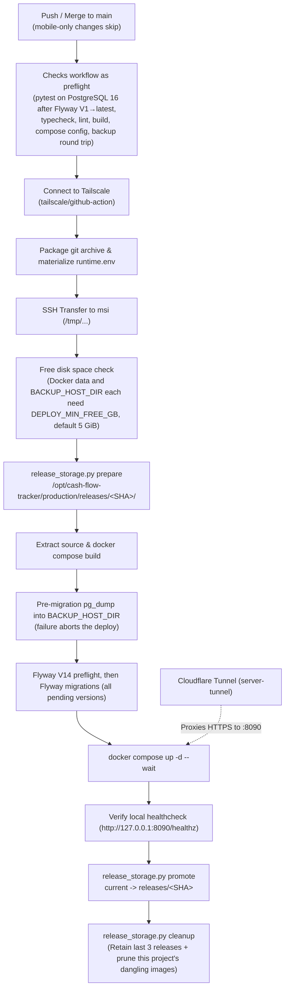

# Cash Flow Tracker — Production Deployment & CI/CD Runbook

This document details the production deployment pipeline, server architecture on `msi` (`msigs63vr`), Cloudflare Tunnel routing, and GitHub Actions CI/CD automation.

---

## 1. Architectural Baseline

Delivery follows the immutable release model established in professional school-agent platforms:



### Core Tenets
1. **Immutable Releases:** No `git pull` on the production server. Code is extracted strictly from pinned Git commit archives into `/opt/cash-flow-tracker/production/releases/<SHA>/`.
2. **Safe Atomic Promotion:** Active production traffic points to `/opt/cash-flow-tracker/production/current`. Symlink promotion occurs **only after** image build, database migration, and container healthchecks succeed. If any step fails, the previous release stays online.
3. **Automated Pruning:** Older releases are cleaned up automatically (retaining active + 3 prior releases). Only dangling images this project built are pruned: `docker image prune --filter label=cash-flow-tracker.managed=true` and `--filter label=com.docker.compose.project=cashflow-production`. The host is shared, so an unfiltered prune is never run.
4. **Isolated Secrets:** Secrets are materialized directly into `<release_dir>/runtime.env` (`mode 0600`) and never committed into Git.
5. **Automated Ingress Routing:** Cloudflare Tunnel proxies traffic to `127.0.0.1:8090` without exposing ports publicly.
6. **Database Backups:** The `backup` service dumps the database nightly and the deploy dumps it before every migration, into a host directory outside the Docker volumes. See [database-backups.md](database-backups.md).
7. **Free Disk Space First:** Before it writes the release tree, builds images or takes the pre-migration backup, the deploy checks the free space of Docker's data directory (`docker info` `DockerRootDir`) and of `BACKUP_HOST_DIR`. If either has less than `DEPLOY_MIN_FREE_GB` GiB free (default 5), the deploy stops and the running release stays online (section 6).
8. **Checks Before Deploy:** `.github/workflows/checks.yml` runs on branch pushes and pull requests, and `deploy.yml` calls it as its preflight. The backend suite runs against a PostgreSQL 16 service migrated by Flyway exactly as production is (`flyway/flyway:10`, baseline on migrate, version 1), with `REQUIRE_TEST_DATABASE=1` so database tests fail instead of being skipped. A push to main that changes only `mobile/**` does not deploy.

---

## 2. Server Topology (`msi` / `msigs63vr`)

- **OS:** Debian GNU/Linux 6.12 (x86_64)
- **Deployment Root:** `/opt/cash-flow-tracker/production/`
- **Owner / Permissions:** `enr1c0:enr1c0` (mode `0750`)
- **Web Ingress Port:** `127.0.0.1:8090` (reverse-proxied by Cloudflare Tunnel)
- **Tailscale IP:** `100.85.113.31`
- **Public Domain:** `https://finance.alfonsusenrico.com`

---

## 3. GitHub Secrets Configuration Checklist

Session cookies default to `COOKIE_SECURE=true`; no repository secret is required for that flag. An unset or empty secret uses the materializer's safe default, and historical runtime cookie flags are not inherited from seed files. An explicit `COOKIE_SECURE=false` causes production startup to fail. Remove that override or set it to true before deploying. The explicitly selected `docker-compose.local.yml` override and the development values in `.env.example` are for local HTTP only; never include them in production.

After deploying this cookie change, the owner must confirm that the production login response's `Set-Cookie` attributes include `Secure`. Inspect attributes only; do not copy session cookie values into logs or reports.

Register these secrets in GitHub under `Settings -> Secrets and variables -> Actions`:

| Secret Name | Description | Example / Note |
|---|---|---|
| `TAILSCALE_AUTHKEY` | Reusable or ephemeral Tailscale auth key | From Tailscale Admin -> Settings -> Keys |
| `DEPLOY_SSH_KEY` | Private SSH key matching `enr1c0@msi` | Matches `~/.ssh/authorized_keys` on `msi` |
| `SESSION_SECRET` | 32-byte random session encryption key | Generated via `openssl rand -hex 32` |
| `POSTGRES_PASSWORD` | Secure PostgreSQL database password | Used by postgres container and backend pool |
| `INVITE_CODE` | Registration invite code | E.g. `CASHFLOWTRACKER` |

*(Defaults for `DEPLOY_HOST=100.85.113.31`, `DEPLOY_USER=enr1c0`, `DEPLOY_PORT=22`, and `DEPLOY_ROOT=/opt/cash-flow-tracker` are configured automatically).*

Optional backup settings, all with safe defaults (see [database-backups.md](database-backups.md#3-configuration)): `BACKUP_HOST_DIR` (default `<DEPLOY_ROOT>/production/backups`), `BACKUP_TIME` (`02:30`), `BACKUP_RETENTION_DAYS` (`14`), `BACKUP_AGE_RECIPIENT` (empty, no encryption).

Optional disk guard: `DEPLOY_MIN_FREE_GB` (default `5`), the whole GiB from 1 to 9999 that a deploy needs free (section 6).

---

## 4. Cloudflare Tunnel Automation Tool (`cf-route`)

A dedicated CLI utility is installed at `/usr/local/bin/cf-route` on `msi`:

```bash
# Route a subdomain to a local port:
cf-route <subdomain> <port>

# Example: Route finance.alfonsusenrico.com to port 8090
cf-route finance 8090
```

The command automatically:
1. Registers Cloudflare DNS via `cloudflared tunnel route dns -f server-tunnel <hostname>`.
2. Updates `/etc/cloudflared/config.yml` before the catch-all `404` rule.
3. Validates ingress syntax.
4. Restarts `cloudflared` systemd service.
5. Verifies public HTTPS reachability and outputs the live URL.

---

## 5. Manual Rollback Procedure

If a deployed release needs to be rolled back to an earlier version:

```bash
# SSH into the server
ssh msi

# Point current release symlink to previous SHA
cd /opt/cash-flow-tracker/production
python3 current/source/scripts/release_storage.py promote \
  --environment-root /opt/cash-flow-tracker/production \
  --release-sha <PREVIOUS_COMMIT_SHA>

# Restart containers with the previous release, including the backup service
cd /opt/cash-flow-tracker/production/current/source
export COMPOSE_PROFILES=backup
export BACKUP_HOST_DIR=/opt/cash-flow-tracker/production/backups
export BACKUP_UID="$(id -u)" BACKUP_GID="$(id -g)"
docker compose --project-name cashflow-production --env-file ../runtime.env up -d --no-build
```

---

## 6. Free Disk Space Guard

A deploy on 2026-11-02 stopped safely because the server disk was full: 285 MB were free and the
pre-migration backup could not be written. The guard below stops such a deploy earlier, before
anything is built or written.

### What the deploy checks

Right after the release files reach the server, and before `release_storage.py prepare`, the image
build, the pre-migration backup and the migrations, the deploy reads:

- the free space of Docker's data directory, from `docker info --format '{{.DockerRootDir}}'`;
- the free space of `BACKUP_HOST_DIR` (default `<DEPLOY_ROOT>/production/backups`).

Each must have at least `DEPLOY_MIN_FREE_GB` GiB available (default 5; a whole number from 1 to
9999, set through the GitHub secret of the same name). The log shows one line per filesystem:

```text
💽 Docker data: 48210 MiB free at /var/lib/docker (minimum 5 GiB).
💽 database backups: 48210 MiB free at /opt/cash-flow-tracker/production/backups (minimum 5 GiB).
```

Below the threshold, or when the free space or Docker's data directory cannot be read, the deploy
exits with an error such as:

```text
❌ Not enough free disk space for Docker data at /var/lib/docker: 285 MiB free, below DEPLOY_MIN_FREE_GB=5 GiB. Aborting before any build, backup or migration; the running release is untouched.
```

Nothing is built, backed up or migrated, no release directory is created, and `current` still
points at the running release. An invalid `DEPLOY_MIN_FREE_GB` (for example `0`, `2.5` or `5GB`)
stops the deploy the same way.

The nightly backup also records `free_mib` on every log line and warns below the same threshold
([database-backups.md](database-backups.md#1-what-runs-and-when)), so a filling disk shows up in
`docker logs ledger_backup` before the next deploy.

### What to do when the disk is full

Any command on the server needs the owner's explicit instruction for that action (`AGENTS.md`,
Production Isolation Guardrail). With that instruction:

1. Look before deleting anything:

   ```sh
   df -h / /var/lib/docker /opt/cash-flow-tracker/production/backups
   docker system df
   du -sh /opt/cash-flow-tracker/production/releases/* /opt/cash-flow-tracker/production/backups
   ```

2. Remove only what this project owns, in this order:
   - this project's dangling images, with the same label filters the deploy uses:
     `docker image prune --force --filter label=cash-flow-tracker.managed=true` and
     `docker image prune --force --filter label=com.docker.compose.project=cashflow-production`;
   - releases beyond the retained three:
     `python3 /opt/cash-flow-tracker/production/current/source/scripts/release_storage.py cleanup --environment-root /opt/cash-flow-tracker/production --compose-project cashflow-production --retain 3`;
   - old dumps past `BACKUP_RETENTION_DAYS` only. Never delete the newest verified dump.
3. **Do not touch other projects' images, containers, volumes or build cache without the owner's
   say.** The host is shared. Never run an unfiltered `docker system prune`, `docker image prune
   --all` or `docker builder prune` on it, and never remove Docker volumes.
4. If this project's own files cannot free enough space, stop and report the `df` and
   `docker system df` output to the owner. Do not lower `DEPLOY_MIN_FREE_GB` to get a deploy
   through.
5. Re-run the deploy from GitHub Actions. Its log shows the free space it found.
